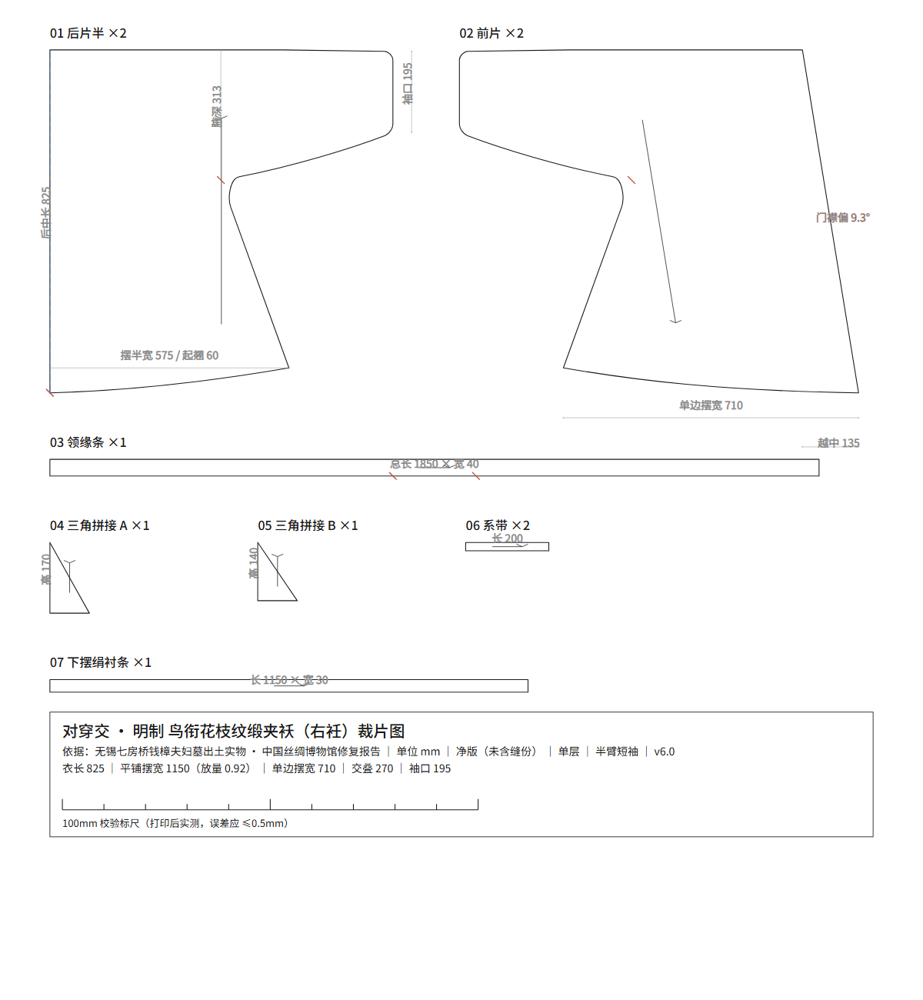

# hanfu-cad · 对穿交半臂（默认口径子程序）

把一件**实物**逆向成可下厂的净版图纸：博物馆官图 / 号型表 → 裁片几何 → `SVG` 裁片图 ＋
`DXF`（CAD 直接开）＋ `pieces.json` 侧车，带布纹方向、对位刀口、100 mm 校验标尺。

> 本目录是**子程序之一**。父程序在 `../hanfu-studio/`；同口径的接袖版在 `../hanfu-jiexiu/`；
> 另一套裁法的深衣 / 原始直领在 `../hanfu-shenyi/`。全仓地图见根目录 `README.md`。

**实物基准**：无锡七坊桥钱樟夫妇墓 · 鸟衔花枝纹缎夹袄（明中后期，无锡博物院藏；
中国丝绸博物馆 2014–2018 保护修复）。

**形制一句话**：对穿交 ＝ 直领对襟的剪裁 ＋ 交领的穿法；袖口止于上臂，右衽、直丝、单层无里布。



## 快速开始

```bash
pip install ezdxf                        # 唯一第三方依赖（出 DXF 用）
cd pattern

python make.py --sex 女 --size M          # 单码
python make.py --sex 女 --all             # 整档 XS~2XL
python make.py --sex 男 --all             # 男装 S~2XL（厂商表基准）
python make.py --sex 女 --height 163 --bust 86    # 直接给净尺寸
python make.py --sex 男 --size L --ease 宽松      # 换放量档
python make.py --params '{"L":860}' --dump-params # 旋钮：覆盖 / 只打印当前值
```

产物落 `out/<profile>_<性别>_<码>/`，同名三件套 `.svg` / `.dxf` / `.pieces.json`。
DXF 是毫米单位（`INSUNITS=4`），五个图层：

| 图层 | 内容 |
|---|---|
| `CUT_轮廓` | 裁片净样闭合多段线 |
| `GRAIN_布纹` | 布纹线（带箭头） |
| `NOTCH_刀口` | 对位刀口 |
| `TEXT_文字` | 片名 × 数量 |
| `DIM_标注` | 100 mm 校验标尺 |

从父程序出图走同一条链：`--sex {sex} --size {size} --out {out}`（注册在 `patterns.json` 的
`banbi`，kind=make，可挂旋钮）。

## 号型与两套基准

`--profile` 不填时按性别自动选：

| 性别 | 默认基准 | 依据 | M 码关键值（mm） |
|---|---|---|---|
| 女 | `artifact` | 钱樟墓文物复原（过审版 v6） | 衣长 825｜平铺胸宽 822｜摆宽 1150｜袖口 195｜领缘 40 |
| 男 | `vendor` | 厂商实物出货尺码表（最高置信度） | 衣长 770｜平铺胸宽 570｜摆宽 798｜袖口 160｜领缘 70 |

推档档差取 GB/T 1335.1/.2-2008（身高 5 cm / 胸围 4 cm）。每个参数的出处、独立来源数、
置信度见 `verification/尺码资料核验.md`；硬口径：**同一篇文章被多站转载只算 1 个来源**。

## 闸门（每一步都可复核，不是"照感觉画版"）

| 闸门 | 做什么 | 实测 |
|---|---|---|
| 术语锚定 | 先写成「A ＝ B 的剪裁 ＋ C 的穿法」这种可判真假的句式，再动笔 | 推翻过一次方向性错误（`PLAN.md` v1.0→v2.0） |
| 量纲锚定 | 标注 > 网格 > 图内已知物 > 人体比例，不许跳级 | 3.89 mm/px，各向异性 ≤2% |
| 像素级叠合 | 裁片按真实拼合关系栅格化，与丝博官图做掩膜配准 ＋ IoU/precision/recall | 正视 **0.8793**、背视 **0.8996**（闸门 0.85） |
| 曲线规范 | 三次贝塞尔 ＋ de Casteljau 精确切分 ＋ 腋下 G1 混合圆角 | 无折线近似 |
| 尺寸自检 | `verification/verify.py` 28 项断言，期望值从 `build.py` 反读 | 28/28 PASS |

配准锚＝模型自身通袖 2180；叠合根＝`archive/v3` 含接袖原尺寸版。
叠合示例（模型蓝 vs 官图红）：`verification/overlay_front.png`。

## 已知残差

1. **袖上缘偏高 ~20 mm**：官图自肩向袖口轻微下垂，现按 0.8° 处理，差约 5 px。
2. **后领高度差 ~25 mm**：官图后领竖直段约 65 mm，本项目领缘条净宽 40（女）/70（男）；成品前建议按 60 复核。
3. **下摆左右角**：摆宽取 1250 略大于官图实测；敏感度测试 1250→1000 仅 +0.5%，不是 IoU 主因。

## 术语与史实

- 原件为**左衽**，本项目按用户指定出**右衽**。**右衽不改变裁片**——两襟同形镜像，右衽只决定穿着时哪片在外。
- 「对穿交」是民间俗称、非文物定名；定义依据孙韬《孙韬文集》4.3/4.4 与汉服颂《科普汉服领襟分类》。
- 摆宽 1250 有据：官图实测 ≈1150，放量系数 0.92 有客观依据（见 `PLAN.md`）。

## 目录

```
PLAN.md              规划与形制论证（v2.0 为现行基准）
pattern/
  build.py           裁片几何（贝塞尔 ＋ G1 混合 ＋ 刀口）
  sizing.py          尺码 / 放量推档
  export_dxf.py      pieces.json → DXF
  make.py            一键换码 CLI（父程序入口）
verification/        overlay.py（叠合）· fit.py（IoU 拟合）· verify.py（28 项）· report.py
sources/             原始资料（丝博官图 19 张、微博手绘、厂商尺码表）
archive/             过审存档点（v3 文物原尺寸 / v6 半臂 放量 0.92）
out/                 出图结果：11 个码 ＋ 清单 ＋ 尺码表
reverse/             逆向中间产物（二值图、裁切块、局部放大）
skill/               方法论技能 garment-pattern-cad（可复用到别的实物）
```

## 方法论已沉淀为技能

`skill/garment-pattern-cad/SKILL.md`：拿它去打任何一件实物都能用。六个动作 ——
术语锚定 → 量纲锚定 → 贝塞尔裁片 → 像素叠合闸门 → 推档 → 出图。
里面另收 9 条实测踩过的坑（折线近似、命令漏同步、"围"当"净平"、小码越界、DXF 中文乱码…），
以及 §9 的对穿交形制结论，可直接引用。

## 常见问题

**能直接裁布吗？** 能，但都是**净版**（未含缝份）。打印后先量 100 mm 标尺，误差应 ≤0.5 mm；
缝份常规另加（侧缝 1 cm、下摆 2–3 cm、领缘 1 cm）。

**只有照片没尺寸能做吗？** 能，前提是图里有可标定参照物；标定优先级见上，不许跳级。

**要不要装 CAD？** 不必。`DXF` 毫米净版，AutoCAD / LibreCAD / CorelDRAW 都能开；不装就看 SVG/PNG。

**「对穿交」和「交领」是一回事吗？** 不是。对穿交 ＝ 直领对襟的剪裁 ＋ 交领的穿法（二次成型）。

**和接袖版、深衣什么关系？** 与 `../hanfu-jiexiu/` 差一条袖缝（衣身一律未动，只加接袖缝 ＋ 4 片 330×222，
通袖 1630）；与 `../hanfu-shenyi/` 差一整套裁法（古制：无肩缝、无接袖缝、无独立前后片）。

## 许可

代码 MIT（见 `LICENSE`）。`sources/` 图片版权归原权利方（中国丝绸博物馆、微博作者、厂商），
仅作研究与比对留证。

---

检索词：hanfu / hanfu pattern / hanfu CAD / traditional Chinese clothing / sewing pattern /
garment pattern making / tailoring / DXF / SVG / ezdxf / dress history / costume reproduction
