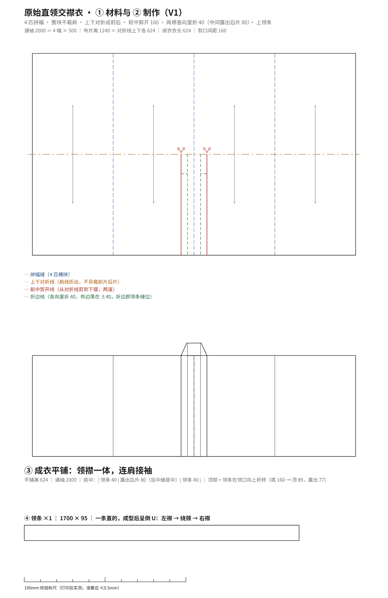
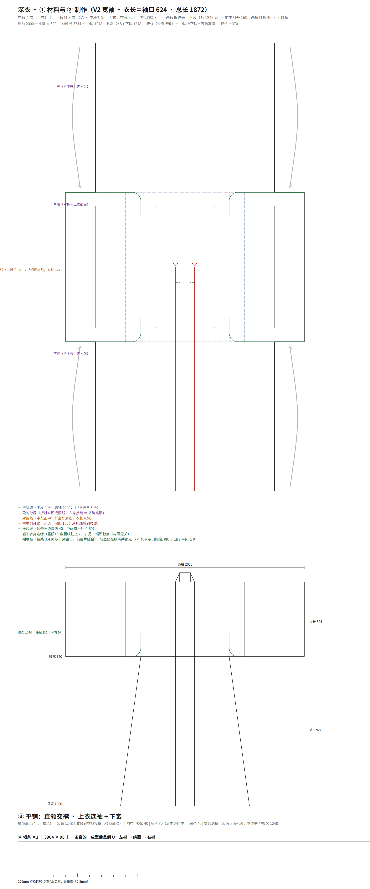
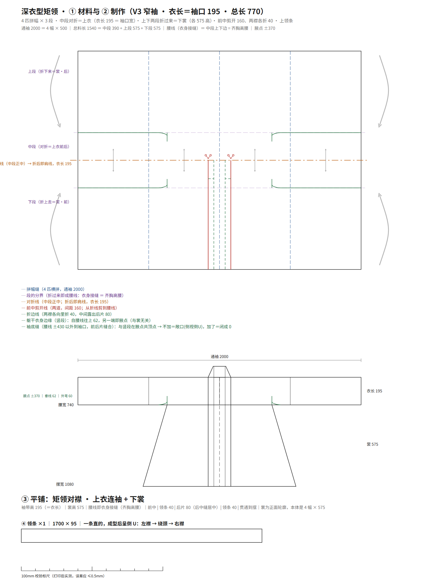

# hanfu-shenyi · 原始直领交襟衣 ＋ 深衣（古制口径子程序）

把孙韬「西周矩领」的过程图逆向成可下厂的裁片图与整衣图纸。工具链照搬 `../hanfu-cad`、
`../hanfu-jiexiu`（同一套 build / export_dxf / preview ＋ 五图层 DXF 规范）。

> 本目录是**子程序之一**，口径＝**古制**：一块布 ＋ 折叠序列，不是"一组裁片"。
> 父程序在 `../hanfu-studio/`；全仓地图见根目录 `README.md`。

## 与半臂／接袖的关系：差一整套裁法

```
对穿交（直领对襟的剪裁 ＋ 交领的穿法，右衽、直丝、无里布）
├─ hanfu-cad   半臂      7 品种 / 10 片   袖口止于上臂
│   └ hanfu-jiexiu  接袖版 8 品种 / 14 片  通袖 1630（只多一道接袖缝）
└─ hanfu-shenyi 深衣      4 片            另一种裁剪 ← 本目录
```

| | 半臂 / 接袖（默认） | 深衣（古制） |
|---|---|---|
| 裁法 | 前后片、领缘、三角、系带分别裁再拼 | 中段整块布上下对折，**布带两端就是袖** |
| 肩缝 | 有（肩线是裁出来的） | **没有**（肩线是折出来的） |
| 袖 | 半臂连身短袖；接袖版另裁接袖缝上 | 衣身与袖之间**没有接缝**；衣长 ＝ 袖肥 ＝ 袖口（同一个数） |
| 片数 | 10 / 14 片 | **4 片**（上衣 / 裳·前 / 裳·后 / 领条） |
| 腰线 | 无 | **有**——中段上下边即腰线，裳拼在这里 |
| 通袖 | 1630（接袖版） | 2000 ＝ 4 幅 × 500 |

**一句话**：与半臂/接袖差一整套裁法，所以推档可以借鉴、**裁片拓扑不能照搬**。
三件共同的：前中剪开／交叠、领缘一条通到摆（领襟一体）、右衽、直丝、无里布。

## 三个版本

| 版本 | 在上一版基础上改什么 | 状态 |
|---|---|---|
| **V1 原始直领交襟衣** | 4 匹拼幅 → 上下对折 → 前中直接剪开两道（间距 160，**不折**）、领条压边每边 40 → 上领条 | ✅ 定稿归档 |
| **V2 深衣（宽袖）** | 材料 2 段 → **3 段**：中段对折成上衣，上下两段折过来当下裳；腰线 ＝ 中段上下边 | ✅ 定稿归档 |
| **V3 深衣（窄袖·便服）** | 两个旋钮：`L_BODY` 624→195（袖口变窄、腰线抬到齐胸）、`GARMENT_L` 1872→770（改成外套长） | 🟡 已出图 |
| ~~矩领短衣~~ | 文章正文的衍生款，**不在交付路线内**（2026-10-29 判定方向错，已清理） | ✗ |

## 两个旋钮决定一切

上衣就是中段对折出来的那条布带，**袖子是它的两端** —— 所以"把衣身缩短"会同时让袖口变窄、
腰线上抬，这两件事是同一个动作，拆不开。

| 旋钮 | 管什么 | V2 礼服 | V3 便服 |
|---|---|---|---|
| `L_BODY` | 衣长 ＝ 袖肥 ＝ 袖口（同时决定腰线高低） | 624（宽袖，腰线正常） | **195**（窄袖，腰线齐胸） |
| `GARMENT_L` | 成衣总长（肩线到摆） | 1872（及踝） | **770**（普通外套长） |

派生量跟着走（裳高 ＝ `GARMENT_L` − `L_BODY`）：

| | 中段 | 裳（上下段各） | 布片高 | 领条 | 定位 |
|---|---|---|---|---|---|
| V2 宽袖 | 1248 | 1248 | 3744 | 3904 × 95 | 礼服 |
| V3 窄袖 | **390** | **575** | **1540** | **1700 × 95** | 便服 |

取值出处：195 取自 `hanfu-cad/pattern/sizing.py` 的「窄袖口 ≈ (净胸围＋放量)/6」M 码；
770 取自厂商实物实测表男 M 衣长。对照图 `out/_cmp_v2_v3.png` 由 `pattern/make_cmp.py` 生成，严格同比例。

## V1 是什么

一块布，四匹横拼，通袖 2000；上下对折成前后（不另裁前后片）；前中剪开两道（间距 160），
**领条压边每边 40**（剪开后不折），中间露出后片 80；另上一条 1700×95 的领条 —— **领襟一体、连肩**。



> **易错点**：折的是 **40** 不是 80。按 80 折，布边会贴到中线、中间就露不出后片
> （160 − 40×2 = 80）。中央的正确读法是 `|领条40| 露出后片80 |领条40|` 三段，
> 不是"一条 160 宽的领子"。详见 `verification/形制核对表.md` §五。

## V2 / V3 是什么



V2 在 V1 之上只加一件事：**材料从 2 段变 3 段**。中段上下对折成上衣前后，上下两段折过来当下裳，
腰线就是中段的上下边。领条要跑到摆，长度 ＝ 2 ×（衣长 624 ＋ 裳高 1248）＋ 前中 160 ＝ **3904**。
腋下画法（用户第五轮定）：垂线自腰线向上 **200** 到腋点，再自垂线下段外弯 **60** 落回腰线；
平铺腰线上不涂色、不加线 —— 袖底缝就是腰线 ±430 以外那一段。



V3 在 V2 上拨两个旋钮：`L_BODY` → **195**、`GARMENT_L` → **770**；裳高 1248→**575**，
布片高 3744→**1540**，领条 3904→**1700**。腋下记号随衣长等比缩（垂线 200→62.5，弯折 70→21.9，外弯仍 60）。

回归 V2：`HANFU_PARAMS='{"L_BODY":624,"GARMENT_L":1872}'`。

## 用法

```bash
cd pattern

# V1 原始直领交襟衣
python build.py
python export_dxf.py 原始直领交襟衣_V1.pieces.json ../out/原始直领交襟衣_V1.dxf
python preview.py    原始直领交襟衣_V1.svg ../out/预览_V1.png --scale 0.62

# V2 / V3 深衣 —— 三步顺序不能换（第一步会重写 pieces.json）
python build_shenyi.py                 # 默认 V3 窄袖·便服
python build_pieces_shenyi.py          # 并入 4 片裁片几何
python export_dxf.py 深衣_V3_窄袖.pieces.json ../out/深衣_V3_窄袖.dxf
python preview.py    深衣_V3_窄袖.svg ../out/预览_V3_窄袖.png --scale 0.5

# 整衣一片 DXF（父程序「导出产物」会自动附带）
python export_dxf_whole.py             # 深衣
python export_dxf_whole_v1.py          # V1
```

产物：`out/` 下 `.svg`（裁片 ＋ 成衣平铺 ＋ 领条）、`.dxf`（5 图层，mm，`INSUNITS=4`）、`.pieces.json`、`预览_*.png`。

**古制版型在父程序里是 `kind=params`**：吃 `HANFU_PARAMS` ＋ `HANFU_OUT`，模式即夹具（V1 / V2 / V3）。

## 关键数（V1，男 M 复原基准）

| 项 | 值 |
|---|---|
| 通袖 | 2000 ＝ 4 幅 × 500 |
| 布片高 | 1248 ＝ 对折线上下各 624 |
| 成衣衣长 | 624（对折后） |
| 前中剪开线 | x = ±80（间距 160），从对折线剪到下摆 |
| 两襟折进 | **各 40**（折后布边落在 ±40，中间露出后片 80） |
| 领条 | 1700 × 95，直丝，整条不断开 |

V2 追加：衣长 ＝ 袖口 ＝ 624、总长 1872、裳高 1248 ×2、腋点 ±370、垂线 200、外弯 60、领条 3904 × 95。
V3 追加：衣长 195、总长 **770**、中段 390、裳高 **575** ×2（布片高 1540）、领条 **1700 × 95**、腰线齐胸、垂线 62.5。

## 量测依据与已确认口径

见 `verification/形制核对表.md`：像素反测表（1 幅 ＝ 500 mm 标定，即 2.129 mm/px；腋下改用高分辨率图
4.875 mm/px 重测）、以及 2026-10-29 用户拍板的三条口径（剪开折边 / 对折对称 / 不独立做前后片）。

## 归档

每个被验收的版本在 `archive/` 留一份**自包含快照**（生成器 ＋ 产物 ＋ 当时口径）：

| 目录 | 验收语 | 快照 |
|---|---|---|
| `archive/V1_原始直领交襟衣_定稿/` | 「对了，对了，正是如此，真正的完美」 | `build_V1.py` ＋ SVG/DXF/pieces ＋ `STATUS.md` |
| `archive/V2_深衣_定稿/` | 「完美，存档，这个已经可以作为非常正式的礼服了」 | `build_shenyi.py` ＋ `build_pieces_shenyi.py` ＋ SVG/DXF/pieces ＋ `README.md` |
| V3 窄袖·便服 | 尚未验收 | 目前只在 `out/` |

## 目录

```
sources/        原始过程图（三步图 ×2、剪裁与平铺、窄袖上身拼缝）
_ref/           读图用的裁切放大，中间产物，不入库
pattern/        build.py（V1）· build_shenyi.py（V2/V3）· build_pieces_shenyi.py
                · export_dxf.py · export_dxf_whole{,_v1}.py · preview.py · make_cmp.py
verification/   形制核对表.md（术语 / 量测 / 口径 / 腋下重测 / V2 收口 / V3 窄袖）
out/            交付物 SVG · DXF · 预览 PNG（`_` 开头的是调试图，`_cmp_v2_v3.png` 例外：对外引用）
archive/        V1 / V2 定稿自包含快照
直交一体_盲区解说.md   写给 AI 的术语长文：为什么"交领/直领"不是两类，是一个连续量的读数
```

## 许可

代码 MIT。`sources/` 图片版权归原作者（孙韬），仅作研究与比对留证。
