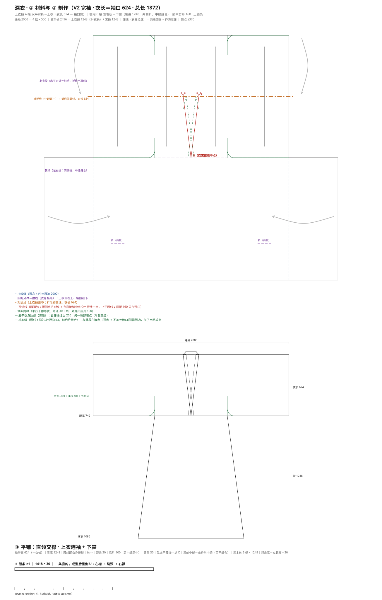
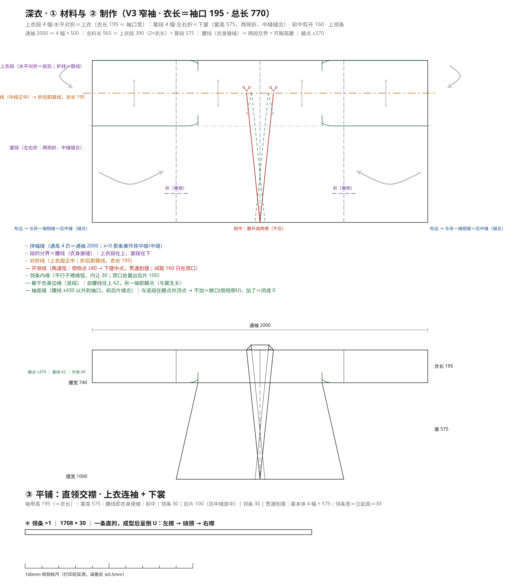

# hanfu-shenyi · 原始直领交襟衣 ＋ 深衣（古制口径子程序）

把孙韬「西周矩领」的过程图逆向成可下厂的裁片图与整衣图纸。工具链照搬 `../hanfu-cad`、
`../hanfu-jiexiu`（同一套 build / export_dxf / preview ＋ 五图层 DXF 规范）。

> 本目录是**子程序之一**，口径＝**古制**：一块布 ＋ 折叠序列，不是"一组裁片"。
> 父程序在 `../hanfu-studio/`；全仓地图见根目录 `README.md`。

## 与半臂／接袖的关系：差一整套裁法

```
对穿交（直领对襟的剪裁 ＋ 交领的穿法，右衽、直丝、无里布）
├─ hanfu-cad   半臂      7 品种 / 10 片   袖口止于上臂
│   └ hanfu-jiexiu  接袖版 8 品种 / 14 片  通袖 1630（只多一道接袖缝）
└─ hanfu-shenyi 深衣      各 3 片          另一种裁剪 ← 本目录
```

| | 半臂 / 接袖（默认） | 深衣（古制） |
|---|---|---|
| 裁法 | 前后片、领缘、三角、系带分别裁再拼 | 上衣段整块布水平对折，**布带两端就是袖** |
| 肩缝 | 有（肩线是裁出来的） | **没有**（肩线是折出来的） |
| 袖 | 半臂连身短袖；接袖版另裁接袖缝上 | 衣身与袖之间**没有接缝**；衣长 ＝ 袖肥 ＝ 袖口（同一个数） |
| 片数 | 10 / 14 片 | **各 3 片**（上衣 / 裳 / 领条）—— V2 裳 6 幅、V3 裳 4 幅 |
| 腰线 | 无 | **有**——上衣段下边＝裳段上边，裳拼在这里 |
| 通袖 | 1630（接袖版） | 2000 ＝ 4 幅 × 500 |

**一句话**：与半臂/接袖差一整套裁法，所以推档可以借鉴、**裁片拓扑不能照搬**。
三件共同的：前中剪开／交叠、领缘一条通到摆（领襟一体）、右衽、直丝、无里布。

## 三个版本

| 版本 | 在上一版基础上改什么 | 状态 |
|---|---|---|
| **V1 原始直领交襟衣** | 4 匹拼幅 → 上下对折 → 前中**弦开领**（颈侧点 ±80 → 下摆中点的弦）、领条＝与弦平行的等带宽 30 → 上领条（1418.2 × 30） | 🟡 已出图 |
| **V2 深衣（宽袖）** | 材料 **2 段**（上衣段 1248 = 2×624 ＋ 裳段 1248）；与 V3 **同一套排布**：裳＝一条 **6 幅（3000）** 带、**左 3 右 3 对称**，两侧（±750）折、两端在后中相接；**开领＝弦 P(颈侧点 ±80, 肩线) → O(0, 腰线中点)，止于腰线**（裳段 x=0 前中缝只不缝合）。领条 1418.2 × 30。脚本 `pattern/build_shenyi.py`（studio `shenyi`） | 🟡 已出图 |
| **V3 深衣·窄袖（便服）** | **2026-11-18 与 V2 分离**，独立脚本 `pattern/build_v3.py`（studio 条目 `shenyiv3`）：材料 **2 段**（上衣段 390 + 裳段 575，同宽 4 幅、无台阶）；裳＝一条 4 幅带**左右折**（两侧折、两端在后中相接）；**开领＝连接颈侧点 (±80, 肩线) 与下摆中点 (0,0) 的弦**（V 形、贯通到摆，前中不合）；领条 1708.3 × 30 | 🟡 已出图 |
| ~~矩领短衣~~ | 文章正文的衍生款，**不在交付路线内**（2026-10-29 判定方向错，已清理） | ✗ |

## 领条算法（唯一来源：`pattern/collar.py`）

V1 / V2 / V3 与默认裁法的 `hanfu-zhidui` **共用同一套领条几何**，公式集中在 `pattern/collar.py`：

| 量 | 公式 |
|---|---|
| 开领 | 弦 P(±x_cut, y_top) → Q(0, 0)，x_cut ＝ 领口宽/2，y_top ＝ 肩线高度 |
| 领条 | 与弦**平行的等带宽**，宽 ＝ `COLLAR_W` |
| 顶半宽（M.x） | `x_cut − k·COLLAR_W`，`k ＝ y_top/n − (1 − x_cut/n)(x_cut/y_top)`，`n ＝ |PQ|` |
| 立起高 | ≡ 带宽 |
| 领条长 | `2n ＋ 2·x_cut` |
| 露出后片 | `2·x_cut − 2·COLLAR_W` ＝ 100 |
| 带宽上限 | `x_cut / k`（超限抛错） |

两个旋钮：**`NECK_W` 领口宽**（80–240）与 **`COLLAR_W` 领条宽＝立起高**（20–60）。
标准值 160 / 30 时：V1 领条 1418.2、V2 1418.2（弦 P→O 止于腰线，与 V1 同值）、V3 1708.3。

## 两个旋钮决定一切

上衣就是中段对折出来的那条布带，**袖子是它的两端** —— 所以"把衣身缩短"会同时让袖口变窄、
腰线上抬，这两件事是同一个动作，拆不开。

| 旋钮 | 管什么 | V2 礼服 | V3 便服 |
|---|---|---|---|
| `L_BODY` | 衣长 ＝ 袖肥 ＝ 袖口（同时决定腰线高低） | 624（宽袖，腰线正常） | **195**（窄袖，腰线齐胸） |
| `GARMENT_L` | 成衣总长（肩线到摆） | 1872（及踝） | **770**（普通外套长） |

派生量跟着走（裳高 ＝ `GARMENT_L` − `L_BODY`）：

| | 中段 | 裳（单段） | 布片高 | 领条 | 定位 |
|---|---|---|---|---|---|
| V2 宽袖 | 1248 | 1248 | 2496 | 1418.2 × 30 | 礼服 |
| V3 窄袖 | **390** | **575** | **965** | **1708.3 × 30** | 便服 |

取值出处：195 取自 `hanfu-cad/pattern/sizing.py` 的「窄袖口 ≈ (净胸围＋放量)/6」M 码；
770 取自厂商实物实测表男 M 衣长。对照图 `out/_cmp_v2_v3.png` 由 `pattern/make_cmp.py` 生成，严格同比例。

## V1 是什么

一块布，四匹横拼，通袖 2000；上下对折成前后（不另裁前后片）；**前中弦开领**（颈侧点 ±80 → 下摆中点的弦，
两线在摆端交于一点）；领条＝与弦平行的等带宽 **30**，压边可见 30、**露出后片 100**；
另上一条 **1418.2 × 30** 的领条 —— **领襟一体、连肩**。

> **易错点**：中央不是"一条 160 宽的领子"，而是 `|领条30| 露出后片100 |领条30|` 三段。
> 领宽处处一致（法向等距带），颈口转折为前片两三角＋后片梯形（底 160 → 顶 107.2，高 30）。

## V2 / V3 是什么



V2 在 V1 之上只加一件事：**加一段裳**。上衣段水平对折成前后，裳段**左右折**（两侧 ±750 折、两端在后中相接），
腰线＝上衣段下边＝裳段上边。**开领＝弦 P(颈侧点 ±80, 肩线) → O(0, 腰线中点)，止于腰线；裳段前中缝只不缝合。领条长 ＝ 2|PO| ＋ 领口宽 ＝ 1418.2**（与 V1 同值）。
腋下画法（用户第五轮定）：垂线自腰线向上 **200** 到腋点，再自垂线下段外弯 **60** 落回腰线；
平铺腰线上不涂色、不加线 —— 袖底缝就是腰线 ±430 以外那一段。



V3 在 V2 上拨两个旋钮：`L_BODY` → **195**、`GARMENT_L` → **770**；裳高 1248→**575**，
布片高 2496→**965**，领条 1418.2→**1708.3**。腋下记号随衣长等比缩（垂线 200→62.5，弯折 70→21.9，外弯仍 60）。

回归 V2：`HANFU_PARAMS='{"L_BODY":624,"GARMENT_L":1872}'`。

## 用法

```bash
cd pattern

# V1 原始直领交襟衣
python build.py

# V2 / V3 深衣 —— 两步顺序不能换（第一步会重写 pieces.json）
HANFU_PARAMS='{"L_BODY":624,"GARMENT_L":1872,"N_SHANG":6}' python build_shenyi.py   # V2
HANFU_PARAMS='{"L_BODY":195,"GARMENT_L":770,"N_SHANG":4}'  python build_v3.py        # V3
python build_pieces_shenyi.py 深衣_V2.pieces.json        # 并入 3 片裁片几何

# 整衣一片 DXF（父程序「导出产物」会自动附带）
python export_dxf_whole.py             # 深衣（吃 HANFU_PARAMS 区分 V2/V3）
python export_dxf_whole_v1.py          # V1

# 同比例对照图
python make_cmp.py
```

产物：`pattern/` 下 `.svg`（裁片 ＋ 成衣平铺 ＋ 领条）与 `.pieces.json`；`out/` 下整衣 DXF 与预览 PNG。

> **注意**：studio 用的是随包 runtime（isolated 模式，`sys.path` 不含脚本目录），
> 所以各脚本开头必须 `sys.path.insert(0, os.path.dirname(os.path.abspath(__file__)))` 才能 `import collar`。

**古制版型在父程序里是 `kind=params`**：吃 `HANFU_PARAMS` ＋ `HANFU_OUT`，模式即夹具（V1 / V2 / V3）。

## 关键数（V1，男 M 复原基准）

| 项 | 值 |
|---|---|
| 通袖 | 2000 ＝ 4 幅 × 500 |
| 布片高 | 1248 ＝ 对折线上下各 624 |
| 成衣衣长 | 624（对折后） |
| 前中弦开领 | 颈侧点 (±80, 肩线) → 下摆中点 (0,0)，间距 160 只在颈口 |
| 领条压边 | 可见 **30**（＝带宽），**露出后片 100** |
| 领条 | **1418.2 × 30**，直丝，整条不断开 |

V2 追加：衣长 ＝ 袖口 ＝ 624、总长 1872、裳高 1248、腋点 ±370、垂线 200、外弯 60、领条 **1418.2 × 30**（弦 P→O 止于腰线）、裳 6 幅。
V3 追加：衣长 195、总长 **770**、中段 390、裳高 **575**（布片高 965）、领条 **1708.3 × 30**、腰线齐胸、垂线 62.5、裳 4 幅。

## 量测依据与已确认口径

见 `verification/形制核对表.md`：像素反测表（1 幅 ＝ 500 mm 标定，即 2.129 mm/px；腋下改用高分辨率图
4.875 mm/px 重测）、以及 2026-10-29 用户拍板的三条口径（剪开折边 / 对折对称 / 不独立做前后片）。

## 归档

每个被验收的版本在 `archive/` 留一份**自包含快照**（生成器 ＋ 产物 ＋ 当时口径）：

| 目录 | 验收语 | 快照 |
|---|---|---|
| `archive/V1_原始直领交襟衣_定稿/` | 「对了，对了，正是如此，真正的完美」 | `build_V1.py` ＋ SVG/DXF/pieces ＋ `STATUS.md`（**2026-10-29 旧口径：领条 1700×95、压边 40**） |
| `archive/V2_深衣型矩领_定稿/` | 「完美，存档，这个已经可以作为非常正式的礼服了」 | 旧排布（上下折）快照，**已被 2026-11-18 的左右折方案取代** |
| V2 / V3（现行口径） | 尚未验收 | 现行脚本与产物在 `pattern/` 与 `out/` |

## 目录

```
sources/        原始过程图（三步图 ×2、剪裁与平铺、窄袖上身拼缝）
_ref/           读图用的裁切放大，中间产物，不入库
pattern/        build.py（V1）· build_v3.py（V3）· build_shenyi.py（V2）· build_pieces_shenyi.py
                · collar.py（★领条算法唯一来源）· export_dxf.py
                · export_dxf_whole{,_v1}.py · preview.py · make_cmp.py
verification/   形制核对表.md（术语 / 量测 / 口径 / 腋下重测 / V2 收口 / V3 窄袖）
out/            交付物 SVG · DXF · 预览 PNG（`_` 开头的是调试图，`_cmp_v2_v3.png` 例外：对外引用）
archive/        V1 / V2 定稿自包含快照
直交一体_盲区解说.md   写给 AI 的术语长文：为什么"交领/直领"不是两类，是一个连续量的读数
```

## 许可

代码 MIT。`sources/` 图片版权归原作者（孙韬），仅作研究与比对留证。
