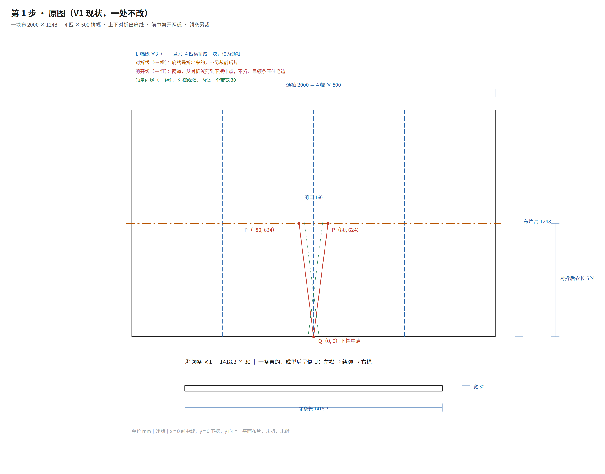
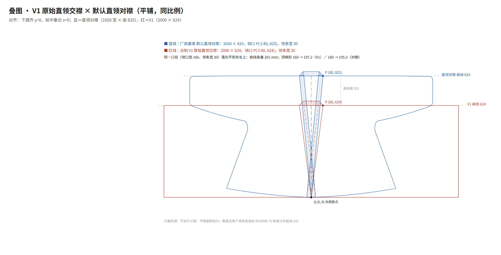

# 原始直领交襟衣 V1 · 构造分步图说（一步一画）

**第 1 步是原图**（V1 现状，一处不改），之后每一步**都在同一张图上改一处**，出图后你点头再走下一步。
一张图只回答一个问题：这一步动了什么、动了多少（mm）。

几何全部取自 `pattern/build.py`（`PIECES` 与常数，不另算），图由 `pattern/step_doc.py` 生成，
出图器 `pattern/docfig.py` 只做着色与排版。

**读图**：黑实线＝布片外框与领条裁片；蓝虚线＝拼幅缝；橙点划线＝上下对折线；
红实线＝前中剪开（领口弦）；绿虚线＝领条内缘（∥ 弦、内让一个带宽）。
坐标 x = 0 前中缝，y = 0 下摆，y 向上，单位 mm，净版。

---

## 第 1 步 · 原图

现状全部摆上来，一处不改：

| 块 | 数量 | 说明 |
|---|---|---|
| 布片 | ×1 | 2000 × 1248 ＝ 4 匹 × 500 **横拼**（横为通袖），**不裁肩** |
| 上下对折线 | — | y = 624：上 624 ＋ 下 624，**肩线是折出来的**，不另裁前后片 |
| 前中剪开 | ×2 | (±80, 624) → (0, 0)：两道，**不折**，靠领条压住毛边 |
| 领条 | ×1 | 1418.21 × 30，一条直的，成型后呈倒 U（左襟 → 绕颈 → 右襟） |

| 量 | 实测 |
|---|---|
| 通袖 ／ 布片高 | 2000.000 ／ 1248.000 |
| 对折后衣长（＝肩线高） | 624.000 |
| 领口宽（两颈侧点间距） | 160.000 |
| 单边襟缘弦长 P→Q | 629.107 |
| 领条 | 1418.21 × 30（立起高 ≡ 带宽 30） |
| 露出后片 | 100 ＝ 160 − 2 × 30 |

**这一步不改任何东西。** 后面每一步都在这一张图上叠加：改的线画红，被替换掉的线改灰虚线留档。

---

## 第 2 步 · 待定

进入一步一画之后，第一处改动由你定，可以动的旋钮（`patterns.json` 里 `zhiling` 已注册的）：

| 旋钮 | 现值 | 范围 | 动了会牵到 |
|---|---|---|---|
| `HALF_L` 对折后衣长 | 624 | 400–900 | 对折线位置、剪开线斜度、襟缘弦长、领条长（全跟着算） |
| `NECK_W` 领口宽 | 160 | 80–240 | 两剪开线间距、领条长、露出后片 |
| `COLLAR_W` 领条宽（＝立起高） | 30 | 20–60 | 领条长、压边宽度、露出后片（`NECK_W − 2·COLLAR_W`） |

说一句「第 2 步改哪个量、改成多少」，我出第 2 步的图（红＝新线，灰虚线＝被替换的线）。

---

## 附 · 叠图（目测用，不参与口径）

蓝＝`../hanfu-zhidui`（默认口径 直领对襟，底为半臂厂商基准）的平铺，红＝V1 的平铺，
**下摆齐 y=0、前中重合 x=0、同一比例**。只画外轮廓与领条／开领几根线，不加尺寸链。

口径是同一套（领口宽 160、领条宽 30），差在三处：

| | V1（古制） | 直领对襟（默认） |
|---|---|---|
| 平铺 宽 × 肩线高 | 2000 × 624 | 1650 × 825 |
| 外轮廓 | 一块布 4 幅通袖，**直角**，无袖窿 | 后片整片，**有袖窿收窄** |
| 领口点 P | (±80, 624) | (±80, 825) ⇒ 肩线差 **201** |
| 顶梯形（底 160 → 顶） | 107.2（高 30） | 105.5（高 30） |
| 两襟带内缘交点（x=0） | y ≈ 236.0 | y ≈ 310.8 |

> 交点按 `y = 带宽 / u_x` 算（u ＝ 襟缘弦方向单位向量）；`../hanfu-zhidui/pattern/flat.py` 图里
> 印的「y ≈ 155」是 `带宽 / (2·u_x)`，小了一半，只影响那句标注、不影响几何。

生成：`python pattern/overlay_zhidui.py`（几何直接取 `../hanfu-zhidui/pattern/flat.py` 的变量与
`build.py` 的常数，不另算）。
