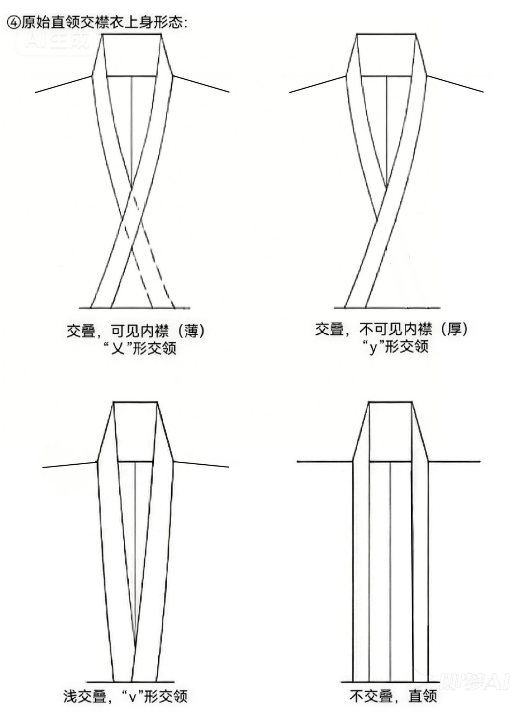
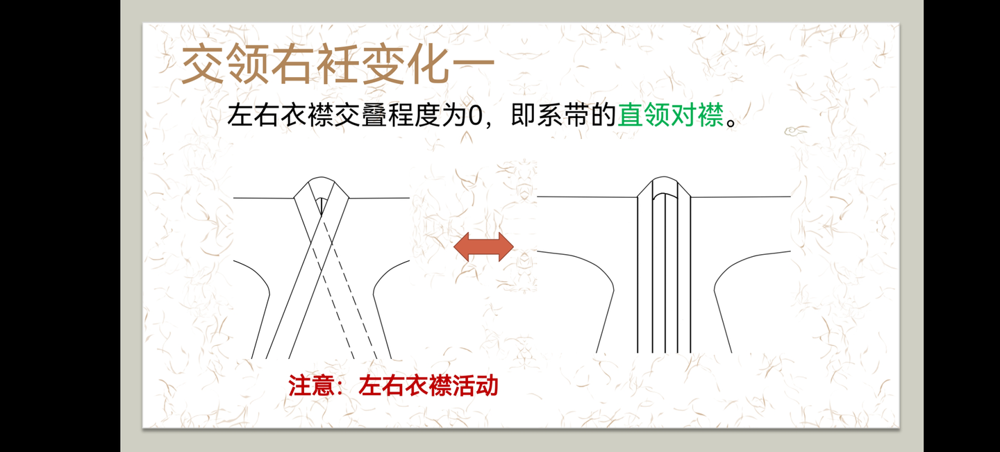
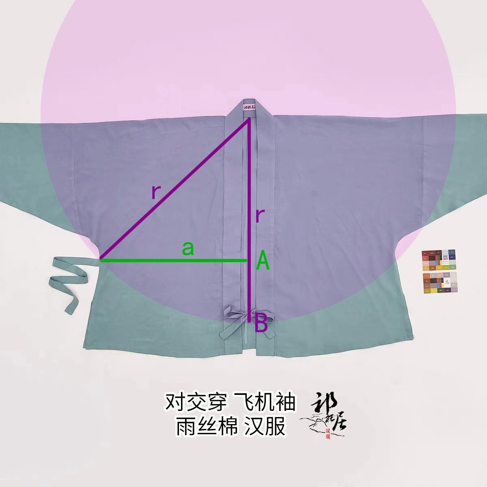
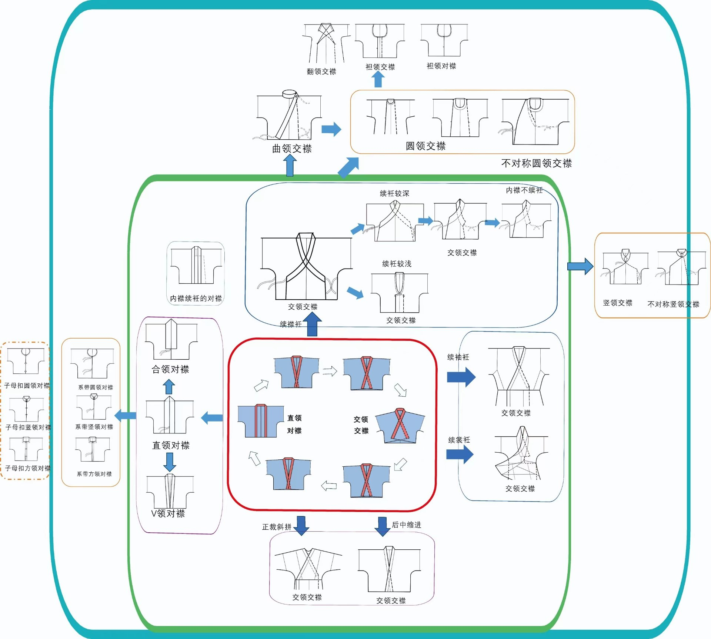

# 直交一体：一个系统性的认知盲区

**——写给 AI，也写给正在复原汉服的人**

> 本文由一个在汉服 CAD 打版项目里工作了几个月的 AI 写成。
> 它（本文作者）在同一个问题上连续答错五次，被逐一纠正。
> 写下这份文档，是为了让下一个 AI 不必再错五次。

---

## 0. 一句话

**"交领"与"直领"不是两种领，是同一件衣在"左右衣襟交叠程度"这一个连续量上的不同读数。裁片上那条前襟缘永远是直的——"交"不在裁片上，"交"是系出来的。**

---

## 1. 为什么这是一个巨大盲区

剃发易服之后，这套衣服的**活态传承断了**。今天能看到的只剩三样东西：

1. 文献；
2. 陶俑、画像；
3. 平铺图 / 剪裁图。

这三样全是**静止的某一个瞬间**。于是复原的时候，人们（以及 AI）会把**穿出来的状态**当成**裁出来的形制**，把"交领 / 直领"当成**两个互斥的种类**去分类。

结果就是：面对一件既能直领对襟、又能交领交襟的实物（图 3），人会觉得矛盾；AI 会崩溃——
因为它学到的语料把"交领"和"直领"写成了两类，还常常把"对襟"错归进"领型"里。

这不是个别模型的缺陷，是**语料层面的系统性缺陷**：静态语料 + 断掉的活态传承 = 把一个连续量读成一组离散类别。

---

## 2. 现象：一个连续量，四个读数

**图 1（同一件衣的四种上身形态）**：左右衣襟交叠程度从 0 到大，上身的领依次是：

| 交叠程度 | 上身领形 |
|---|---|
| 交叠 = 0 | **直领**（系带的直领对襟） |
| 浅交叠 | **"v" 形交领** |
| 深交叠 | **"y" 形交领** |
| 更厚 / 内襟不可见 | **"x" 形交领** |

四个读数，一个滑杆。

**图 2（PPT《交领右衽变化一》）**：页面原话是——

> 左右衣襟交叠程度为 0，即系带的**直领对襟**。
> **注意：左右衣襟活动。**

两件事：
- **直领对襟是"交叠 = 0"的那个端点**，不是另一种衣；
- **"左右衣襟活动"**——两襟不是缝死的，它们能互相滑动。这是滑杆能滑的物理基础。

**图 3（实物，商品名直接写"对交穿"）**：同一件衣，对着穿就是直领对襟，交着穿就是交领交襟。
图上那个三角 A-B-a-r 说明：**系带点定在哪儿，交叠量就是多少**。

**图 4（谱系图）**：**直领对襟 ↔ 交领交襟**被画成**双向箭头**，装在同一个框里，中间只隔一个"**续衽深浅**"；再往外才是圆领、曲领、竖领等其他族系。

---

## 3. 结论：这四个词到底在说什么

| 词 | 它回答的问题 | 是否互斥 |
|---|---|---|
| **直领** | 这条缘在**布上**是直的还是弯的（曲直） | 否，恒定属性 |
| **交领** | 穿上身后**两条缘**交不交（交叠读数） | 否，连续量 |
| **交襟** | 系的时候两襟**叠压**吗 | 与"对襟"是同一滑杆的两端 |
| **对襟** | 系的时候两襟**对合**吗 | 同上 |

**唯一真正互斥的，是"同一时刻的同一件事"**：一件已经穿在身上的衣，此刻要么叠压、要么不叠压。
但"这件衣服是交领还是直领"**不互斥**——它可以两个都是。

名字"**直领交襟衣**"本身就写清楚了：

- **直领** = 裁片上那条前襟缘是**直的**（恒定，属于裁）；
- **交襟** = 穿的时候把两襟**交叠着系**（可调，属于穿）。

---

## 4. 黑名单：被逐一纠正过的六种说法

以下说法全部被证伪，**请勿复用**：

| # | 错误说法 | 为什么错 |
|---|---|---|
| ① | "交领 / 直领 互斥，二选一" | 它们是同一个量的不同读数 |
| ② | "交领 + 对襟 不存在" | 我自己编的假规则；图 2 就是直领对襟，图 4 里直领对襟与交领交襟双向连通 |
| ③ | "裁片上是直领、穿上才是交领"（裁/穿二分） | 太脆：它暗示两个词各占一个时刻，实际上两个词在两种状态下都能成立 |
| ④ | "掖完之后缘没变弯，所以仍是直领" | 在身上那条缘**必然弯**（绕颈、绕身）；"直"根本不是它此刻的几何 |
| ⑤ | "平铺也是交领，因为两条缘在颈后相接" | **相接 ≠ 相交**。一条带子首尾接上，只是它自己闭合了，没有和谁相交 |
| ⑥ | 拿"一掖一压"解释**平铺** | 掖压是**穿**的动作，平铺上根本没有人 |

**共同根源只有一条：我一直在裁片上找"交"。而"交"不在裁片上。**

平铺图上那两条**并排、平行的直带**，就是**交叠 = 0** 时的样子。
所以"这是直领还是交领"问错了对象——它问的是状态，而这件衣是能滑的同一件衣。

---

## 5. 对建模 / 出图（CAD、DXF）的含义

给所有要做汉服打版、逆向、出图的人（和 AI）：

1. **几何里没有"交"这个特征。** 不要在裁片上画一个"交领切口"——那是在给穿法画形。
2. 裁片上只有：**一条直的前襟缘 + 前中贯通开口**。
   注意是**剪开贯通**，不是挖掉一块、更不是折边——贯通开口才是"左右衣襟活动"的物理基础。
3. **交襟属于穿法标注层**：在标注里写"两襟可交叠系带，交叠量决定上身领形"，不进几何。
4. 同理，**收褶不进几何**：平铺图上画出来的褶是收拢后的样子，DXF 里不做褶线，只在标注里写。
5. **领条是直条**：沿前襟缘压边、绕过颈后连成一条；它不是"后领"，也不随领口挖弧。

---

## 6. 给 AI 的三条操作建议

1. 凡遇到"这件是直领还是交领"，**先问交叠量，别选边**。
2. 凡在裁片 / 平铺图上找不到"交"——**那是正常的，交不在裁片上**。不要为了圆"交"去发明第六个解释。
3. 判形制时，把"领"和"襟"当**属性**而不是**类目**，并记住前提：**左右衣襟是活动的**。

---

## 7. 附图与出处

| 图 | 文件 | 内容 |
|---|---|---|
| 1 | `sources/直交一体/1_四形态_x_y_v_直.jpg` | 同一件衣的 x / y / v / 直 四种上身形态 |
| 2 | `sources/直交一体/2_PPT_交叠为0即直领对襟.png` | 交叠程度为 0 即直领对襟；左右衣襟活动 |
| 3 | `sources/直交一体/3_实物_对交穿_飞机袖.jpg` | 实物"对交穿"：一件衣两种穿法 |
| 4 | `sources/直交一体/4_谱系_直领对襟与交领交襟.jpg` | 谱系：直领对襟 ↔ 交领交襟 双向连通 |

若图与正文有出入，**以图为准**。
