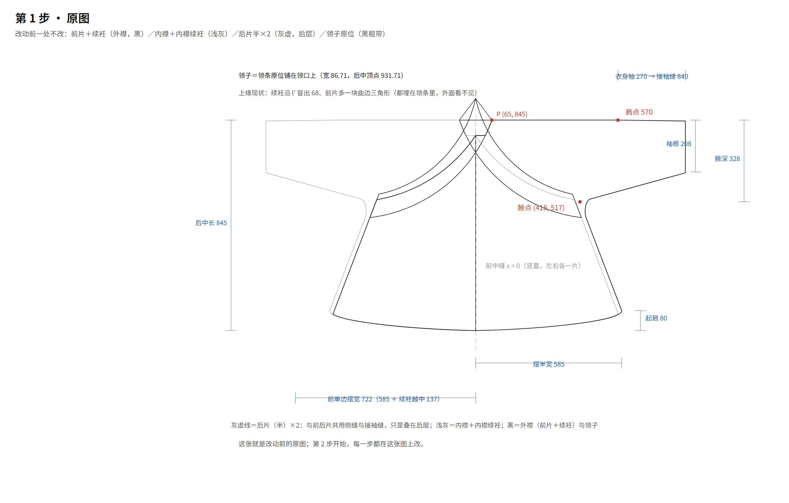
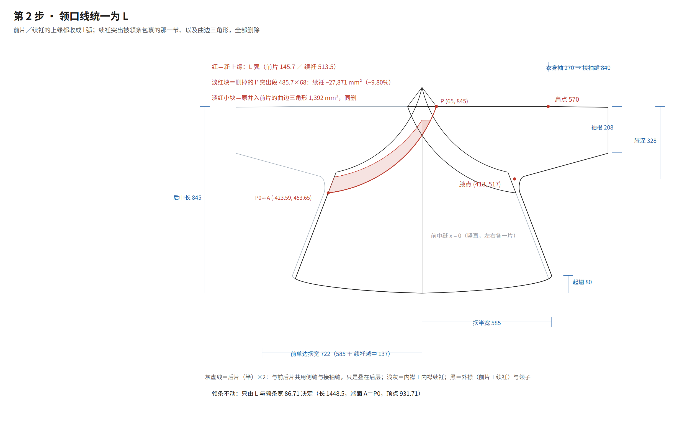
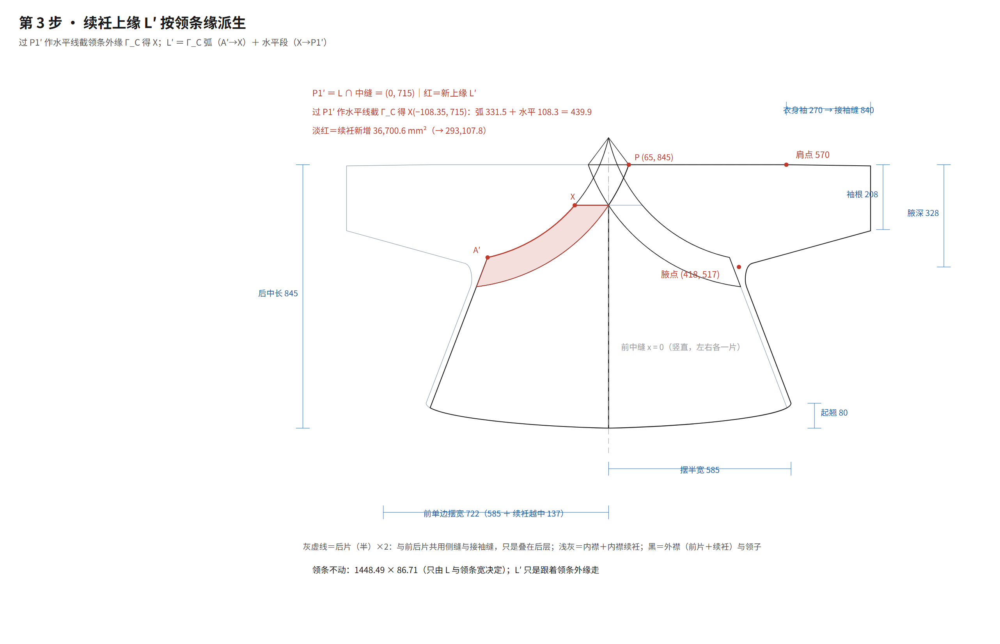

# 明制高交领 · 构造分步图说（一步一画）

**第 1 步是原图**（现状一处不改），之后每一步**都在同一张图上改一处**，出图后你点头再走下一步。
一张图只回答一个问题：这一步动了什么、动了多少（mm）。

几何全部取自 `geo.pieces(d)` / `flat.collar_band(d)`（不另算），图由 `pattern/step_doc.py` 生成，
出图器 `pattern/docfig.py` 只做着色与排版。

**读图**：黑实线＝外襟（前片＋续衽）与领子；浅灰＝内襟＋内襟续衽；灰虚线＝后片半×2（后层）；
蓝＝尺寸；红＝关键点。坐标 x = 0 前中缝（后片同一 x 为后中连折），y = 0 下摆，y 向上；mm，净版。

---

## 第 1 步 · 原图

现状全部摆上来，一处不改：

| 片 | 数量 | 说明 |
|---|---|---|
| 前片（中缝右边） | ×1 | 左缘＝前中缝；领口宽 65 ／ 深 130；肩／袖／侧缝／摆沿用父版型 |
| 续衽（中缝左边） | ×1 | 左缘＝HH1（∥原外缘，H 在 l′ 上离 P2′ 20）；上缘＝l′（H→(0,783)）；右缘＝中缝 |
| 内襟（前片镜像） | ×1 | 与外襟同形，压在下层 |
| 内襟续衽（续衽镜像） | ×1 | 同上 |
| 后片（半·模板原样） | ×2 | 直接调 `hanfu-jiexiu` 的构造，不是复制坐标 |
| 领缘条 | ×1 | 全衣一条，1448.5 × 86.7 |

| 量 | 实测 |
|---|---|
| 后中长 / 摆半宽 / 起翘 | 845.000 / 585.000 / 80.000 |
| 腋深（腋点高） | 328.000（517.000） |
| 肩点 / 衣身袖 / 接袖缝 | 570.000 / 270.000 / 840.000 |
| 袖根（接袖缝处袖高） | 208.000 |
| 前单边摆宽 | 722.000（585 ＋ 续衽越中 137） |
| 领子宽 ／ 后中顶点 | 86.711 ／ 931.710 |

**这一步不改任何东西。** 后面每一步都在这一张图上叠加：改的线画红，被替换掉的线改灰虚线留档。

---

## 第 2 步 · 领口线统一为 L

**一句话**：领口线只有一条——**l 圆（o, R）**。前片、续衽的上缘都收成它；
续衽原来沿 l′ 往上冒、**被领条包在里面的那一节**，以及那个**曲边三角形**，一起删掉。

| 删/留 | 量 |
|---|---|
| 新上缘：前片 L 弧 P1(0,715) → P(65,845) | 145.709 mm |
| 新上缘：续衽 L 弧 P1 → P0 | 513.536 mm |
| 删：l′ 突出段（H → P1′，485.729 × 68） | 续衽 −27871.4 mm²（−9.80%）→ **256407.1** |
| 删：曲边三角形 P1′-n-P1（原并入前片） | 前片 −1392.0 mm² → **500363.1** |
| 续衽片角 ＝ P0 ＝ 领条端面 A | (−423.587, 453.649) |
| **领条：不动** | 1448.49 × 86.71，顶点 931.71 —— 只由 L 与领条宽决定 |

**为什么能这么删**：领条的内缘就是 L 弧（P0→P），端面 A 落在 HH1 上；续衽上端只要**收到 L**，
片角就正好压在领条端面上，不再有布钻进领带里。l′ 退成一条**定位弧**——只用来定 H，不出现在任何裁片边上。

自检（`python pattern/verify.py`，不一致 0 项）新增/替换的四条：
`前片上缘在 L 圆上（半径差 0.000）`、`续衽上缘在 L 圆上（0.000）`、`续衽片角 ＝ P0（0.000）`、
`领条内缘 ＝ L（0.000，无第二套领口线）`（第 3 步把这些换成 Γ_C 那组，见下）。

---

## 第 3 步 · 续衽上缘 L′ 按领条缘派生

**一句话**：续衽的上缘不再自己造一条线，**跟着领条外缘走**。领条宽一变，L′ 自己跟着变。

`P1′` 的定义改了：**L 与中缝所在直线（x = 0）的交点**，即 **(0, 715)**（原 P1 那个点）；
原来「l′ ＝ L 竖直上移 68」的 783 作废，68 那个量现在只用于定位 H（决定 HH1 落在哪儿）。

| 量 | 实测 |
|---|---|
| P1′ ＝ L ∩ 中缝 | (0.000, 715.000) |
| 过 P1′ 的水平线截 Γ_C（R−C＝507.924）得 X | (−108.346, 715.000) |
| L′ 弧段：Γ_C（A′→X） | 331.550 mm |
| L′ 水平段：X→P1′ | 108.346 mm |
| **L′ 合计** | **439.896 mm** |
| 左缘 A′→H1（仍走 HH1） | 516.380 mm |
| 续衽面积 | 256407.1 → **293107.8**（＋36,700.6） |
| 领条 | 1448.49 × 86.71 —— **不动** |

**这叫「高位接衽」，属工艺优化类描述**：续衽上端做到领条外缘、在领带底下留料，缝合时不至于缩到缝线以下。
几何上它只是 L′ 那两条线（Γ_C 弧 ＋ 水平段）；代码里只有数学定义，「高位接衽」这个叫法只出现在文档。

**为什么是 715**：中缝上取 715 正好是两条 L 弧在领口 V 处的交点；再往上就是领口开口，
续衽不该伸进去。所以 L′ 一到 P1′ 就用水平段接到中缝，V 口里干干净净。
